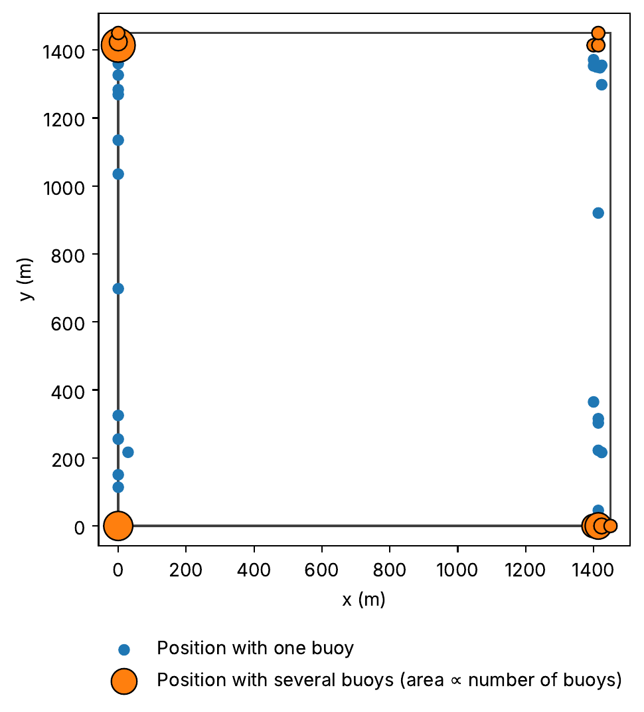

# Findings of the post-publication review

This document reports the findings of a review of the results and code in this repository, carried out after the publication of the paper *Optimization of Wave Energy Farms Using Surrogate Models and Metaheuristics* (MICAI 2025 Workshops, LNAI 16264, pp. 459–470, DOI [10.1007/978-3-032-17930-2_33](https://doi.org/10.1007/978-3-032-17930-2_33)).

- **Date:** November 21, 2026.
- **Origin:** the initial observations come from Dr. Miguel Raggi Pérez. The figures in this document were recomputed from the files in this repository.
- **Scope:** the analysis of the best configuration (finding 1) was done **for Perth 100 only**. It has not been checked whether the same happens in Perth 49, Sydney 49 and Sydney 100.

## Summary

| # | Finding | Status |
|---|---------|--------|
| 1 | The optimizer does not enforce a minimum distance between buoys, and the best configurations exploit this. The 10.11 MW reported for Perth 100 is an extrapolation of the surrogate model and has not been validated with the simulator. | Reported |
| 2 | The figures in Table 4 of the paper match the 100 Optuna trials, not 100 independent runs of the tuned configuration. In Sydney 100 the test favors DE, not PSO. | Reported (the table belongs to the published paper) |
| 3 | Errors in the Differential Evolution code (`m_best`, `c_exp`). | Fixed in the code; results not recomputed |

**Main consequence:** the power values of the optimized configurations are predictions of the surrogate model. They cannot be presented as an improvement over the results reported by Neshat et al. (2020) until they are validated with a hydrodynamic simulator. The results table in the [README](../README.md) should be read with this caveat.

---

## 1. The best configurations exploit the lack of a minimum distance

### What was found

The optimizer searches a continuous space, with each coordinate normalized between 0 and 1, and **does not enforce any minimum distance between buoys**. The best configurations exploit this.

The best Perth 100 configuration is trial 98 of DE/best/1/bin (file `optimization/perth_100/de/perth_100_de_DE-best-1-bin_optuna_results.csv`), with a predicted power of **10.1097 MW**:

| Measure | Value |
|---------|-------|
| Buoys | 100 |
| Distinct positions (rounded to 1 mm) | **52** |
| Positions occupied by more than one buoy | 11 |
| Pairs of buoys at the same position | 217 |
| Pairs of buoys less than 50 m apart | 814 (includes the 217 above) |
| Coordinates at the limit of their search range (0 or 1 normalized) | 99.5 % |

*Best Perth 100 configuration (predicted power of 10.11 MW). The 100 buoys occupy 52 distinct positions. Orange circles mark positions with several buoys, and their area is proportional to the number of buoys.*

### Comparison with the training data

The training data (`data/raw/WEC_Perth_100.csv`, 7,277 configurations, and its cleaned version `data/clean/perth_100.csv`, 2,737 configurations without duplicates) behave very differently:

| Measure | Training data |
|---------|---------------|
| Configurations with overlapping buoys (less than 1 m apart) | None |
| Configurations where all buoys are at least 50 m apart | 99.1 % (raw data), 99.2 % (without duplicates) |
| Minimum distance between buoys found (in the sample) | 4.70 m |
| Maximum power | **7.3645 MW** |

The proportions were computed on a random sample of 2,500 configurations from each dataset (seed 0).

### What it means

The surrogate model was trained only on physically feasible configurations, so it has no information about what happens outside that domain. By exploring the space freely, the metaheuristic reached regions where the model extrapolates and predicts high values with no support in the data.

Therefore, the 10.11 MW value:

- is an **extrapolation** far from the maximum of the training data (7.36 MW);
- has **not been validated** with the hydrodynamic simulator;
- cannot be presented as an improvement over the state of the art (7.35 MW in Neshat et al., 2020).

In principle, the same caveats apply to the other values in the README results table. Their individual review is pending.

### How to reproduce

1. For each subset, the files `optimization/<subset>/*/*_optuna_results.csv` store the best configuration of each trial in `best_positions`, with every coordinate normalized, and the value of the objective function in `best_total_power` (power as a z-score, with negative sign).
2. Coordinates are converted to meters with `x = min + position × (max − min)`, using the per-column values in `data/clean/perth_100_raw_stats.json`. The columns are interleaved: X1, Y1, X2, Y2, …
3. Power is converted to MW with `(−best_total_power × total_power_std + total_power_mean) / 10⁶`, using the values in the same file.

---

## 2. Figures in Table 4 of the paper

### What was found

The paper states that each algorithm was run 100 times with its tuned configuration and that Table 4 summarizes those 100 runs. However, the figures in Table 4 match the statistics of the **100 Optuna trials** of each algorithm, and each trial uses different hyperparameters.

Three rows of the table were recomputed from the `*_optuna_results.csv` files (maximum / median / minimum / mean / standard deviation, in MW):

| Subset and algorithm | Table 4 of the paper | Recomputed from the 100 trials |
|----------------------|----------------------|--------------------------------|
| Perth 100, DE/best/1/bin | 10.110 / 10.056 / 7.548 / 9.730 / 0.657 | 10.110 / 10.057 / 7.548 / 9.730 / 0.657 |
| Sydney 100, DE/rand/1/exp | 7.750 / 7.620 / 7.129 / 7.558 / 0.158 | 7.750 / 7.621 / 7.129 / 7.558 / 0.158 |
| Sydney 100, PSO | 7.605 / 7.589 / 7.570 / 7.590 / 0.008 | 7.605 / 7.589 / 7.570 / 7.590 / 0.008 |

The only difference is 0.001 MW in some medians, attributable to rounding. The remaining rows of the table were not checked.

Therefore, the table **does not compare the performance of the metaheuristics under equivalent conditions**: it describes how results vary when the hyperparameters change, not the variability of 100 independent runs of the tuned configuration.

### Sydney 100: the test favors DE

The note under Table 4 says that in Sydney 100 "PSO was superior to DE/rand/1/exp (p = 0.0068)". Recomputing the two-sided Wilcoxon rank-sum test between the 100 DE/rand/1/exp values and the PSO values gives **p = 0.0068** (statistic z = +2.707), but the sign is **in favor of DE**:

- the median of DE (7.620 MW) is higher than the maximum of PSO (7.605 MW);
- the maximum of DE (7.750 MW) is higher than that of PSO (7.605 MW).

The p-value is correct, but the direction of the conclusion associated with it in the paper is not.

### Status

Table 4 is part of the published paper and cannot be modified. This document records the observation.

---

## 3. Errors in the Differential Evolution code

Three errors were found, all present in the four files `optimization/{perth_49,perth_100,sydney_49,sydney_100}/de/*_de.py`. The PSO scripts do not have them.

### 3.1 `m_best` sorts the population while it is being iterated

The `m_best` function ran `pop.sort(...)`, that is, it sorted `pop` in place, while the `for x in pop` loop in `DifferentialEvolution` was iterating over that same list. After sorting, the best individual sits at position 0, which the loop had already passed. As a result, the best individual **is never processed and does not pass to the next generation** (unless it was already the first one), and the original first individual ends up duplicated. This affects the DE/best variants.

In a test with a toy function (40 generations, 10 seeds), the best value of the population got worse in 17 generations with DE/best/1/bin and in 42 with DE/best/1/exp. With the fix, in none.

**Fix:** replace the sorting with `best = min(pop, key = lambda x: x[1])`.

### 3.2 `c_exp` treats the value 0 as an "empty position"

In the exponential crossover, the function ended with `if u[i] == 0: u[i] = x[i]`, assuming a 0 meant a position that had not been copied. But 0 is a valid and very frequent value, because coordinates are clipped to the box boundary. Zero values copied from the mutant vector were replaced by those of the parent.

**Fix:** initialize `u = x.copy()` and remove that final loop.

### 3.3 `c_exp` picks the starting position from a shifted range

The statement `rd.randint(0, n)` includes `n` in its range (in Python, `randint` is inclusive at both ends). Since the position is taken modulo `n`, position 0 was about twice as likely as the others. In the test, with `n = 10`, the frequency of position 0 was 0.180 instead of 0.100.

**Fix:** use `rd.randint(0, n - 1)`.

### Status

All three fixes were applied to the code in the repository and checked with a toy function, without running the experiments or using the repository's data or models.

**The results stored in `optimization/` and those reported in the paper were generated with the previous version of the code and have not been recomputed.** The effect of the errors on those results has not been quantified.

---

## What would be done differently

1. Enforce a minimum distance between buoys in the optimizer, consistent with the one in the training data (50 m), either as a constraint, a penalty or a repair step.
2. Validate the best configurations with the hydrodynamic simulator and report the simulated value next to the surrogate-model prediction.
3. Perform independent runs of the tuned configuration of each algorithm, with the same number of objective-function evaluations.
4. Repeat the experiments with the corrected Differential Evolution code.
5. Check whether the findings of section 1 also appear in Perth 49, Sydney 49 and Sydney 100.
